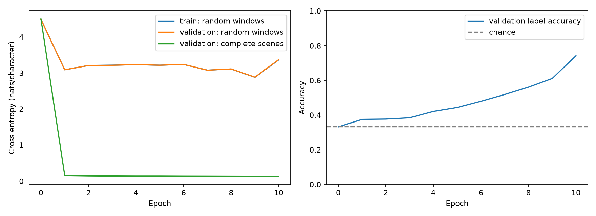

# Lily: first ten epochs

[Executed notebook](../../../notebooks/Lily_KG.ipynb) · [Runpod notebook](https://rovm0pofzpp6n9-8888.proxy.runpod.net/lab/tree/workspace/lily-kg/Lily_KG.ipynb) · [HF dataset](https://huggingface.co/datasets/chewiesays/lily-kg-mini-v1) · [W&B run](https://forge.coreweave.com/wandb/peepaclan/gpt_train_detour/runs/stg4wug8)

The 10,812,768-parameter character GPT completed ten epochs, 3,750 updates and 37,992,350 training targets in 402 seconds, including evaluation and excluding artifact upload. It started from random weights. Epoch ten had the lowest complete-scene validation loss and is both the best and final checkpoint.

| Evaluation | Greedy exact answer accuracy | Records |
| --- | ---: | ---: |
| Fresh validation scenes, all four tasks | 74.17% | 1,200 |
| Fresh validation scenes, reach/order tasks only | 59.83% | 600 |
| Reserved endpoint combinations, reach/order tasks only | 60.33% | 600 |
| Paired validation graphs with new wording | 37.00% | 1,200 |

Chance is 33.33%. The composition test contains only reach/order tasks, so compare it with the matched 59.83% subset rather than the 74.17% aggregate. This single seed shows no clear additional penalty for reserved endpoint pairs; it does not establish systematic reasoning. Familiar-format accuracy is 93.33% for color, 83.67% for location, 65.67% for heavier-than and 54.00% for reachability.

Unknown is explicitly supervised. Validation Unknown recall is 79.25% and precision is 84.53%; composition recall is 57.00%. These numbers do not demonstrate spontaneous uncertainty awareness or identity.

## Why text loss is insufficient

Complete-scene validation cross entropy fell from 4.5036 to 0.1260 nats per character. Repeated templates occupy most tokens, so this low loss coexists with substantial answer errors.

The original TinyStories-style diagnostic uses 20 random batches of 64 windows, each 256 characters. Its final validation loss is **3.3717**, versus final train loss **3.3648**. These windows start mid-scene or cross boundaries, while Lily trains on complete scenes with ignored padding. The diagnostic therefore measures a distribution shift, not the primary training objective. The notebook preserves both curves. Neither loss protocol makes raw Lily/TinyStories losses a controlled comparison across corpora.

## What the transfer test means

The paraphrase split reuses validation graphs but changes wording. Its eleven new word forms are `color`, `compared`, `does`, `for`, `have`, `of`, `out`, `sits`, `to`, `where`, and `within`. Its 37.00% generated accuracy measures combined vocabulary and phrasing transfer, rather than syntax alone. Closed-label accuracy is 37.50%; unconstrained generation sometimes produces an invalid answer string. The other two splits have equal closed-label and generated accuracy.

The next useful comparison is a new dataset version with vocabulary exposure controlled, then multiple seeds and equal-token static versus curriculum runs. Keep these tests fixed and record any future decisions made after seeing them. This run establishes a static baseline; no curriculum controller, RL or identity objective was trained.

## Saved evidence

`config.json`, `history.json`, and `summary.json` preserve the recipe, all eleven evaluation points including initialization, and final metrics. The three `*_predictions.json` files preserve every evaluation prompt, truth, label prediction and greedy answer. `verification.json` independently recounts those predictions and records the matched task subset and vocabulary shift. The notebook completed every code cell without errors. Dataset checks verified every generated label/proof, split separation, answer balancing, context fit and nine logic corner cases.

On the pod, `/workspace/lily-kg/out/` holds `best.pt`, `last.pt`, and `best_weights.pt`; W&B also stores the best inference model artifact and evaluation files. The HF input revision is pinned in `config.json` and [dataset receipts](../../../data/lily-kg/). The original GitHub `v1` release still refers to the Shakespeare/TinyStories baselines.
